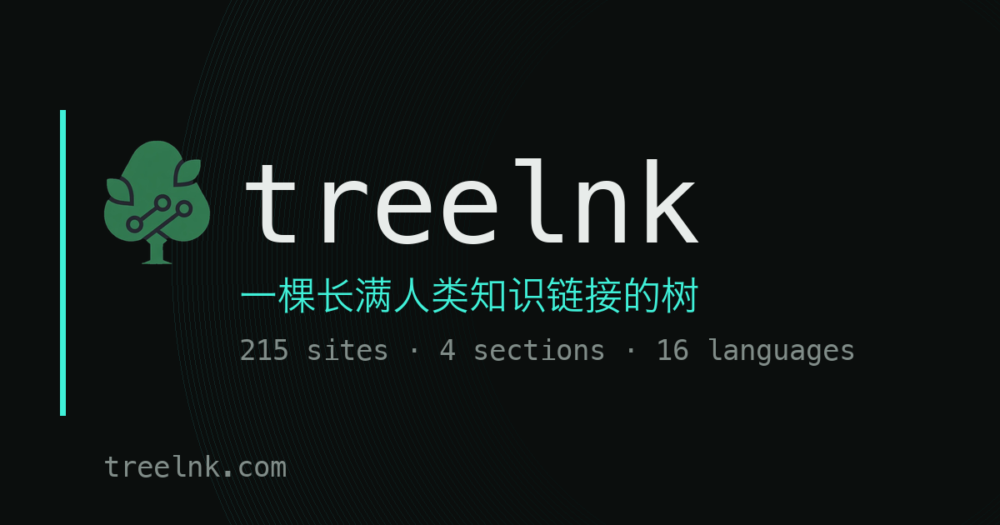

# treelnk

**[treelnk](https://treelnk.com)** —— 一棵长满人类知识链接的树。

A tree of links to human knowledge. 215 hand-picked sites, four sections, 16 languages.

- 🌿 **有趣网站** — [treelnk.com](https://treelnk.com/) — 好玩、能动手、看完会长点什么的站点
- 📚 **雅思素材** — [treelnk.com/ielts](https://treelnk.com/ielts) — 按雅思写作 14 个常考话题整理的英文阅读/引用来源
- 🎓 **高校官网** — [treelnk.com/uni](https://treelnk.com/uni) — 各国高校官网，按地区分组
- 🔍 **免费论文** — [treelnk.com/paper](https://treelnk.com/paper) — 开放获取的论文库与预印本

## 这是什么

treelnk 是一个**人工筛选**的网站目录。每一条收录都带一句「为什么值得看」,而不是把搜索结果的机器摘要堆在一起。

四个板块共 215 个站点;界面有 16 种语言(简体中文 / 繁體中文 / English / Español / Français / Deutsch / Português / Italiano / Русский / 日本語 / 한국어 / العربية / हिन्दी / Bahasa Indonesia / Türkçe / Tiếng Việt)。

关于这棵树的设计取舍:[treelnk.com/about](https://treelnk.com/about)

## What it is

**treelnk** is a hand-curated web directory. Every entry carries a short note on *why it is worth your time* instead of a machine-generated abstract.

Four sections — interesting sites, IELTS writing material, university official sites, and open-access papers — with 215 entries across 16 interface languages.

## 链接

| | |
|---|---|
| 站点主页 | <https://treelnk.com> |
| 点击排行 | <https://treelnk.com/rank> |
| 站点地图 | <https://treelnk.com/sitemap.xml> |
| 提交收录 | <https://treelnk.com/submit> |

## 说明

这个仓库是 treelnk 的**公开项目页**,只放介绍与链接;站点本身的源码与运维配置不在公开仓库里。

Issues 里欢迎推荐值得收录的站点(也可以直接用站点的 [提交页面](https://treelnk.com/submit))。

---

treelnk · treelnk.com · 一棵长满人类知识链接的树
